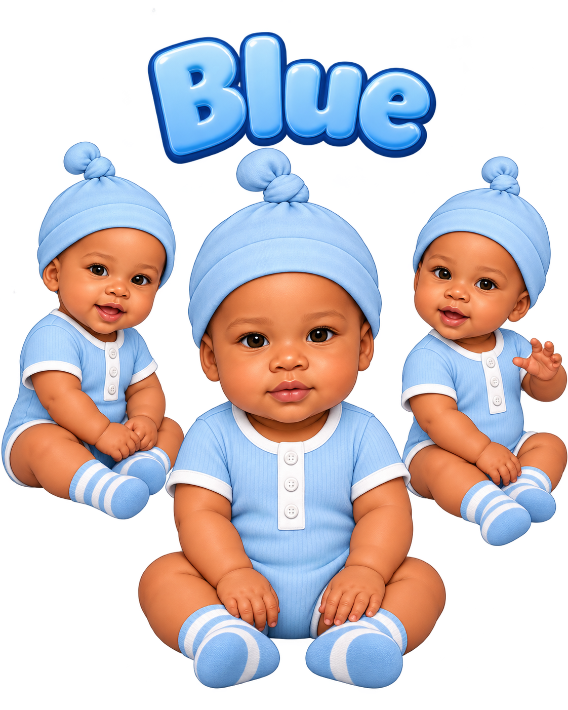

# Blues Tunes Kids Production

I created Blues Tunes Kids as a children’s media brand that brings original characters to life through music, animation, and illustrated books. This portfolio documents my approach to character development and visual quality review.

## Character sample

Blue is one of the recurring characters. I use a reference image to check that his hairstyle, warm-brown skin tone, and baby proportions stay recognizable as the pose, camera angle, or lighting changes.

## How I review a scene

1. **Check the brief.** Identify who appears in the scene, what they’re doing, and the intended framing.
2. **Compare against the character reference.** Check hair, skin tone, outfit, and proportions. When a character looks older or larger than intended, I flag the specific proportion that needs adjustment.
3. **Check continuity.** Compare neighboring shots for unintended outfit changes, duplicate characters, and distracting changes in appearance.
4. **Review the revision.** Recheck the flagged detail and make sure the correction works in the full scene.

## Related work

“Cousins Above All” is a finished Blues Tunes Kids music video. Learn more about the brand on the [Blues Tunes Kids website](https://bluestuneskids.com/story).
